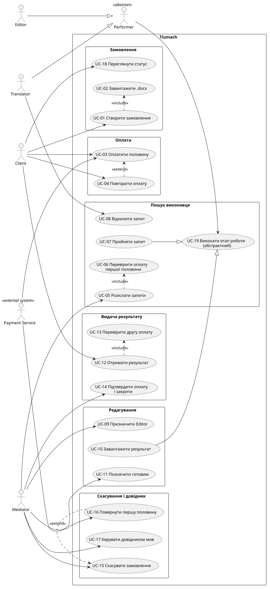

# Use Cases: платформа Tlumach

## Діаграма

Джерело: [`diagrams/use-case.puml`](diagrams/use-case.puml). Після змін puml перерендерити svg.

## Актори

| Актор | Тип | Примітка |
|---|---|---|
| Client | людина | |
| Mediator | людина | |
| Translator | людина | спеціалізація Performer |
| Editor | людина | спеціалізація Performer |
| Performer | людина (абстрактний) | лише абстракція діаграми, не сутність моделі; має спільний UC-17 |
| Payment Service | зовнішня система | підтверджує оплати (UC-03) |

## Перелік UC

| UC | Назва | Актори | Зв'язки |
|---|---|---|---|
| UC-01 | Створити замовлення | Client | include UC-02 |
| UC-02 | Завантажити .docx | Client | |
| UC-03 | Оплатити половину замовлення | Client, Payment Service | |
| UC-04 | Повторити оплату | Client | extend UC-03 (оплату відхилено) |
| **UC-05** | **Розіслати запити** | Mediator | детально: Gherkin G01–G05, FR-001…FR-006 |
| UC-06 | Прийняти запит | Translator | |
| UC-07 | Відхилити запит | Translator | |
| UC-08 | Призначити Editor | Mediator | |
| UC-09 | Завантажити результат | Editor | |
| UC-10 | Позначити замовлення готовим | Mediator | |
| UC-11 | Отримати результат | Client | |
| UC-12 | Підтвердити оплату і закрити замовлення | Mediator | |
| UC-13 | Скасувати замовлення | Mediator | |
| UC-14 | Повернути першу половину | без власного актора | extend UC-13 (ніхто не взявся) |
| UC-15 | Керувати довідником мов | Mediator | |
| UC-16 | Переглянути статус замовлення | Client | |
| UC-17 | Переглянути свої завдання | Performer | |

## Що змінилось порівняно з першою версією

- Колишні UC-06 «Перевірити оплату першої половини» і UC-13 «Перевірити другу оплату» — дії системи, а не потреби актора. Вилучені з діаграми й перенесені у вимоги (FR-001 та вимога до «Отримати результат»).
- UC-14 «Повернути першу половину» більше не має Payment Service як актора: повернення запитує система (на відміну від UC-03, де Payment Service сам повідомляє про оплату).
- Абстрактний UC «Виконати етап роботи» вилучено: його не реалізував жоден актор. Узагальнення Performer лишилось, але тепер у нього є реальний UC-17.

## Обґрунтування include / extend

- **include** (UC-02): без перевірки й завантаження файлу замовлення не створюється, крок обов'язковий.
- **extend** (UC-04, UC-14): гілки за умовою. Повторна оплата потрібна лише після відмови. Повернення потрібне лише якщо ніхто не взявся за переклад. При простроченні другої оплати перша половина лишається `paid`, повернення немає.